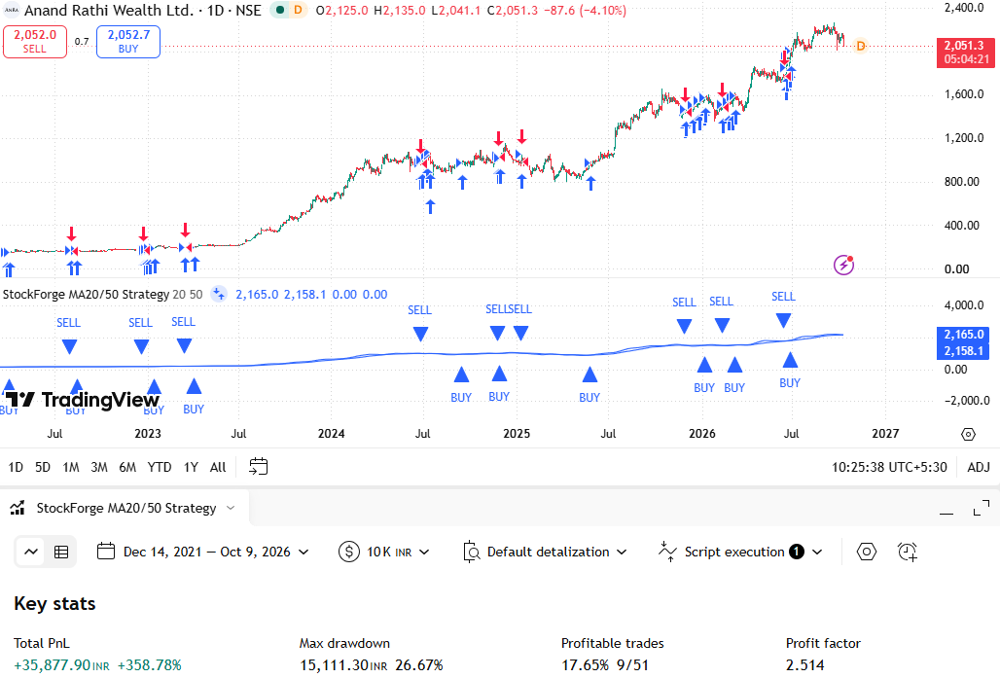

# StockForge 📈   &nbsp;   [](https://github.com/localghosters/StockForge/actions/workflows/secretshield.yml)

An open-source Python **backtesting and research framework** for stock and ETF strategies:
daily data from Yahoo Finance, a small and readable backtest engine, honest-testing tools
(next-open fills, cost stress, luck tests), an interactive web dashboard, and a daily
paper-trading signal generator.

> **Status: under development.** StockForge is a research tool, not a money machine. See
> [What the research found so far](#what-the-research-found-so-far) before drawing any
> conclusions, and the [disclaimer](#disclaimer) before risking any capital.



> Go to the `images/` folder for full preview details.

---

## Contents

- [Features](#features)
- [Quick start](#quick-start)
- [Usage](#usage)
- [Configuration](#configuration)
- [Project structure](#project-structure)
- [How it works](#how-it-works)
- [What the research found so far](#what-the-research-found-so-far)
- [Known limitations](#known-limitations)
- [Dependencies](#dependencies)
- [Documentation](#documentation)
- [Testing and CI](#testing-and-ci)
- [Contributing](#contributing)
- [License](#license)
- [Disclaimer](#disclaimer)

---

## Features

- **Data pipeline:** downloads split/dividend-adjusted daily OHLCV via `yfinance`, caches it in a local SQLite database.
- **Strategies:** regime-gated trend breakout and mean reversion (original), a long-only multi-lookback **trend filter** with optional volatility targeting, and a legacy SMA crossover.
- **Backtest engine:** next-bar execution, fees on turnover, short borrow cost, and two fill models: `close` (optimistic) and `next_open` (realistic).
- **Diagnostics:** trade log, action log, trade statistics, regime table, per-strategy contribution, year-by-year table.
- **Web dashboard (Streamlit + Plotly):** candlestick chart with buy/sell markers and regime shading, equity vs buy & hold, drawdown, diagnostics, CSV export, and a parameter-sweep heatmap.
- **Robustness tools:** 20-year multi-asset comparison, cost sensitivity, bootstrap Sharpe confidence intervals, a random-timing luck test, and a paired Sharpe-difference test against buy & hold.
- **Live signals (paper trading):** `live/signals_today.py` prints and logs next-session target weights for a trend-following basket. It places no orders.
- **Tests and CI:** pytest suite run on every push, plus secret scanning workflows.

---

## Quick start

Requires **Python 3.12** (what the project is developed and tested on) and internet access for the first data download.

```bash
git clone https://github.com/localghosters/StockForge.git
cd StockForge

python -m venv .venv
# Linux / macOS / WSL:
source .venv/bin/activate
# Windows (PowerShell):
.venv\Scripts\Activate.ps1

pip install -r requirements.txt          # runtime
# or, to also run the tests:
pip install -r requirements-dev.txt

python main.py                           # CLI run on the tickers in config.py
streamlit run dashboard.py               # web dashboard
```

---

## Usage

Run every command from the repository root.

| What | Command | Notes |
|---|---|---|
| CLI backtest | `python main.py` | Downloads data, saves it to SQLite, prints diagnostics per ticker, opens charts if `SHOW_CHARTS = True`. |
| Web dashboard | `streamlit run dashboard.py` | Everything adjustable from the sidebar. |
| Honest-testing study | `python -m research.robustness` | ~20 years, many assets. Downloads a lot; takes a few minutes. Optional tickers: `python -m research.robustness SPY QQQ GLD`. |
| Daily paper-trading signals | `python -m live.signals_today` | Run once a day **after** the market closes. Options: tickers, `--vol-target 0.10`. |
| Compare strategy variants | `python -m research.compare_variants` | Reads prices from the local database, so run `main.py` first. |
| Tune/check sweep | `python -m research.frequency_sweep` | Parameter variants scored on a tune period and a check period. Needs the database too. |
| Long vs short run | `python -m research.long_vs_short` | Same flow as `main.py`, for comparing long-only against long+short. |
| Tests | `python -m pytest -q` | Needs `requirements-dev.txt`. |

### Dashboard

Sidebar controls: tickers (plus extra comma-separated ones), scored-from date, starting capital, fee rate, shorting and borrow rate, **strategy** (original regime-gated / trend filter / trend filter + 10% vol target), **fill model** (close or next open), regime thresholds, and strategy parameters.

Tabs:

1. **Overview:** summary table, rebased equity curves, strategy vs buy & hold bars.
2. **Ticker detail:** candlestick with buy/sell markers and optional regime shading, equity vs buy & hold, drawdown, strategy contribution, trade stats, regime table, year by year.
3. **Trades & export:** trade log, action log, by-side breakdown, CSV downloads.
4. **Parameter sweep:** heatmap of any two parameters against Sharpe, total return or max drawdown (max 150 cells). Sweeping on the scored period and picking the best cell is overfitting; tune on earlier data, then check on later data.

### Live signals

```bash
python -m live.signals_today --vol-target 0.10
```

Default basket: SPY, QQQ, EFA, TLT, GLD. Each asset gets at most `1/N` of the portfolio, scaled by its trend score (the fraction of its 50/100/200-day moving averages that price is above); the rest is cash. Each run is appended to `results/signals_log.csv` with a `changed` flag versus the previous run. **Paper trade for months before considering real money.**

---

## Configuration

All settings live in `config.py`.

| Setting | Default | Meaning |
|---|---|---|
| `TICKERS` | AAPL, MSFT, RELIANCE.NS, GOOGL, JPM, XOM, INFY.NS, HDFCBANK.NS | Universe for `main.py` and the dashboard. |
| `START_DATE` / `END_DATE` | `2018-01-01` / `None` | Data download range. Data before `EVAL_START` is warm-up for indicators. |
| `EVAL_START` | `2023-01-01` | Start of the scored period. |
| `INITIAL_CAPITAL` | `100000` | Starting equity. |
| `FEE_RATE` | `0.001` | Cost per unit of turnover (10 bps). A long→short flip pays twice. |
| `ALLOW_SHORT` | `True` | Enable short positions. **Recommended `False`**: shorting lost money in every robustness test. |
| `SHORT_BORROW_RATE` | `0.02` | Annual borrow cost on short positions. |
| `ADX_TREND` / `ADX_RANGE` | `25` / `20` | ADX thresholds for the TREND and RANGE regimes. |
| `VOL_CAP` | `0.80` | Volatility percentile above which a day is labelled CRISIS (strategies off). |
| `SHORT_WINDOW` / `LONG_WINDOW` | `20` / `50` | Windows for the legacy SMA crossover. |
| `SAVE_FILES` | `False` | Write per-ticker CSVs and the overview chart to `results/`. |
| `SHOW_CHARTS` / `DETAIL_TICKERS` | `True` / `["AAPL"]` | Show matplotlib charts from `main.py`, and for which tickers. |
| `DB_PATH` | `database/stockforge.db` | SQLite price cache (created on first run). |

---

## Project structure

```
StockForge/
├── main.py                      # CLI entry point
├── dashboard.py                 # Streamlit web dashboard
├── config.py                    # all settings
├── requirements.txt             # runtime dependencies
├── requirements-dev.txt         # + pytest
│
├── data/fetch.py                # yfinance download (adjusted OHLCV)
├── database/db.py               # SQLite cache: create_tables, save_prices, load_prices
│
├── strategies/
│   ├── indicators.py            # ADX, rolling volatility rank, RSI, hold-state machine
│   ├── regime.py                # TREND / RANGE / CRISIS / NEUTRAL / WARMUP labels
│   ├── trend_breakout.py        # Donchian-style breakout (TREND regime)
│   ├── mean_reversion.py        # RSI(2) mean reversion (RANGE regime)
│   ├── trend_filter.py          # long-only 50/100/200 trend filter + optional vol target
│   ├── sma_crossover.py         # legacy SMA crossover
│   └── selector.py              # build_signal(): runs and combines strategies
│
├── backtesting/
│   ├── engine.py                # run_backtest(): positions, fees, borrow, fill models
│   └── pipeline.py              # run_pipeline(), sweep_grid(): shared by CLI and dashboard
│
├── portfolio/
│   ├── metrics.py               # total/annual return, Sharpe, max drawdown, summary
│   ├── diagnostics.py           # trade/action logs, trade stats, regime table, yearly table
│   └── robustness.py            # bootstrap Sharpe CI, random-timing test, paired Sharpe test
│
├── visualisation/plots.py       # matplotlib overview and detail charts (CLI)
├── research/                    # study scripts (robustness, compare_variants, ...)
├── live/signals_today.py        # daily paper-trading signals
├── tests/                       # pytest suite
├── archive/stockforge_v1/       # original TradingView Pine script and first Python version
├── images/                      # screenshots
└── .github/workflows/           # tests + SecretShield scans
```

---

## How it works

**Pipeline.** `download_prices` → `save_prices` / `load_prices` (SQLite) → `build_signal` → `run_backtest` → metrics and diagnostics. `backtesting/pipeline.py::run_pipeline` wraps everything from prices onward, and both `main.py` and the dashboard call it, so their numbers always agree.

**Regimes** (`strategies/regime.py`). Each day is labelled using the ADX and a rolling volatility percentile (252-day window, so no lookahead):

| Regime | Rule |
|---|---|
| TREND | ADX ≥ `ADX_TREND` |
| RANGE | ADX ≤ `ADX_RANGE` |
| CRISIS | volatility rank ≥ `VOL_CAP` (overrides the others) |
| NEUTRAL | everything in between |
| WARMUP | indicators not yet available |

**Strategies.**

- `trend_breakout`: enter when the close breaks above the prior 20-day high, exit below the prior 10-day low (mirrored for shorts). Allowed in TREND only.
- `mean_reversion`: enter when RSI(2) < 10, exit when the close is back above its 5-day average. Allowed in RANGE only.
- `trend_filter`: position = fraction of the 50/100/200-day moving averages that the close is above (0, ⅓, ⅔ or 1). Optional `target_vol` scales exposure down, never above 1×. Long-only, always on.
- `build_signal` zeroes a strategy's signal outside its allowed regimes and averages the active strategies.

**Engine** (`backtesting/engine.py`).

- `position = signal.shift(1)`: a signal known at today's close is held from the next bar.
- `fill="close"` assumes you trade at the close that produced the signal (optimistic). `fill="next_open"` trades at the next day's open: the old position earns the overnight gap, the new one earns open→close.
- Fees are charged on turnover; short positions pay `SHORT_BORROW_RATE / 252` per day.
- Outputs `equity`, `buy_hold`, `strategy_return`, `position`, `trade`, and the signal/regime columns.

**Robustness tools** (`portfolio/robustness.py`, used by `research/robustness.py`).

- `sharpe_ci`: block-bootstrap confidence interval for the Sharpe ratio.
- `random_timing_test`: keeps your exposure and trade count but shifts positions to random dates. If real timing adds nothing, the actual Sharpe lands inside the shifted distribution (high p-value).
- `sharpe_diff_ci`: paired bootstrap of Sharpe(strategy) − Sharpe(buy & hold). If the interval includes 0, the difference is indistinguishable from noise.

---

## What the research found so far

These are results from the project's own `research.robustness` run (2006–now, split into 2006–2014 and 2015–now, next-open fills, 10 bps costs, equal-weight daily-rebalanced portfolio of asset-class ETFs: SPY, QQQ, ^NSEI, EFA, TLT, GLD). They will change as data refreshes.

| Variant | 2006–14 annual / Sharpe / max DD | 2015–now annual / Sharpe / max DD |
|---|---|---|
| Buy & hold | 9.7% / 0.75 / −41.6% | 10.8% / 0.99 / −21.0% |
| Original regime-gated, long-only | −0.2% / −0.03 / −13.2% | 0.0% / 0.02 / −9.5% |
| Original regime-gated, long+short | −5.8% / −1.09 / −43.8% | −3.5% / −0.75 / −36.7% |
| Close > 200-day SMA | 8.1% / 1.00 / −9.3% | 6.1% / 0.84 / −13.6% |
| Trend filter 50/100/200 | 6.4% / 0.88 / −10.9% | 5.5% / 0.85 / −12.7% |
| Trend filter + 10% vol target | 4.1% / 0.93 / −4.7% | 3.5% / 0.79 / −9.4% |

What this says:

1. **The original regime-gated strategy has no demonstrated edge.** About 0% a year as a portfolio, negative after 30 bps of costs, no single ticker beating random timing at p < 0.1. Adding shorts made it strictly worse.
2. **Trend filtering on a diversified basket holds up** as a *drawdown-control* tool: depending on the variant it earns roughly 30–85% of buy & hold's return (the plain 200-day filter is at the top of that range, the vol-targeted version at the bottom) with far shallower drawdowns, and a similar or slightly lower Sharpe. It does **not** beat buy & hold on return.
3. **It does not work on single stocks.** Trend variants beat buy & hold on Sharpe for 0 of 14 single tickers since 2015. The benefit comes from diversification across assets.
4. 2006–14 contains 2008, which flatters trend following; 2015–now is mostly a bull market, which hurts it.

---

## Known limitations

- **Cash earns 0%** in the engine. Low-exposure strategies are therefore understated and the comparison with buy & hold is tougher than reality. A cash-yield setting is the next planned fix.
- **Costs are a flat per-turnover fee.** No bid/ask spread, market impact, taxes, or brokerage specifics.
- **Daily bars only;** fills assume your order executes at the open (or close) price.
- **Survivorship and hindsight bias in the default universe:** the default tickers are well-known winners. Index/asset-class ETFs are the more honest test set.
- **`^NSEI` is an index, not tradable.** India-listed ETFs (e.g. NIFTYBEES.NS, GOLDBEES.NS) have shorter histories and different costs.
- **Shorting:** retail investors generally can't hold overnight short positions in Indian cash equities; the long+short results are illustrative only.
- **Taxes and currency** (including buying US ETFs from India) are not modelled. Check the current rules with a tax professional.
- **Multiple testing:** every variant you try and every heatmap cell you inspect raises the chance of finding a "good" result by luck. Use the tune/check split and the luck tests.

---

## Dependencies

**Runtime** (`requirements.txt`)

| Package | Used for | Where |
|---|---|---|
| [yfinance](https://github.com/ranaroussi/yfinance) | Downloading daily price data | `data/fetch.py` |
| [pandas](https://github.com/pandas-dev/pandas) | Data handling and all backtest maths | everywhere |
| [numpy](https://github.com/numpy/numpy) | Numerics, bootstrap and luck tests | strategies, `portfolio/robustness.py` |
| [matplotlib](https://github.com/matplotlib/matplotlib) | Charts from the CLI | `visualisation/plots.py`, `main.py` |
| [streamlit](https://github.com/streamlit/streamlit) | Web dashboard | `dashboard.py` |
| [plotly](https://github.com/plotly/plotly.py) | Interactive dashboard charts | `dashboard.py` |

**Development** (`requirements-dev.txt`): everything above plus [pytest](https://github.com/pytest-dev/pytest).

**Standard library only:** `sqlite3` (price cache), `argparse`, `pathlib`, `datetime`, `random`, `sys`.

> `scipy`, `statsmodels` and `sqlalchemy` were previously listed in `requirements.txt` but are not imported anywhere in the codebase, so they have been removed.

These projects are distributed under their respective licenses.

---

## Documentation

| Document | What it covers |
|---|---|
| [docs/METHODOLOGY.md](docs/METHODOLOGY.md) | How to evaluate a strategy honestly, the luck tests, metrics glossary, and a log of what has been tried |
| [docs/PAPER_TRADING.md](docs/PAPER_TRADING.md) | Using the daily signal script, what to track, and practical caveats |
| [docs/ROADMAP.md](docs/ROADMAP.md) | Planned improvements |
| [CHANGELOG.md](CHANGELOG.md) | What changed |
| [CONTRIBUTING.md](CONTRIBUTING.md) | Development setup and what new strategies need to show |

---

## Testing and CI

```bash
pip install -r requirements-dev.txt
python -m pytest -q
```

The suite covers the engine (including both fill models), the pipeline and parameter sweeps, the trend filter, and the robustness statistics. GitHub Actions runs:

- **Tests:** `pytest` on every push and pull request (Python 3.12; installs only pandas, numpy and pytest).
- **SecretShield:** secret scanning on every push and pull request, plus a weekly scheduled scan (Sundays, 00:00 UTC).

---

## Contributing

Contributions of strategies, indicators, metrics, data handling, visualisations, tests and docs are welcome. Please read [CONTRIBUTING.md](CONTRIBUTING.md) first. For larger changes, especially new strategies, open an issue to discuss it before doing significant work. If you add a strategy, evaluate it with `research.robustness` rather than a single-ticker chart.

---

## License

MIT, see [LICENSE](LICENSE).

---

## Disclaimer

StockForge is for research and education. It is **not financial advice**, and nothing here is a recommendation to buy or sell any security. Backtests are hypothetical, rely on assumptions that differ from real trading, and do not guarantee future results. You can lose money. Do your own research and consider speaking to a qualified financial and tax professional.
